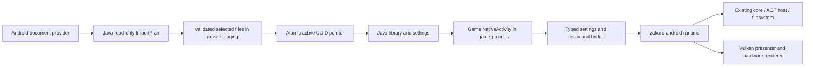

# Development and APK build

Start at [README](../README.md). This page describes the emulator APK; a game's
native code has a separate [ABI/build contract](native-library.md).

## Architecture



`android/app/src/main/java/io/github/zakuro/android` owns Android UI, SAF storage,
metadata, retained import workers, private save links and errors. The crate
`crates/zakuro-android` builds `libzakuro_android.so` and owns lifecycle, input,
motion, audio and runtime/presenter integration. Core/GPU/FS/CPU crates remain the
engine; desktop egui settings/menus are not automatically part of Android.
`Game` runs in its own `:game` process. Lifecycle commands must keep polling events
while paused or displaying an error; do not destroy a live native surface to
show a Java menu. See the matrix for the current command/settings integration.

Imports inventory metadata and validate ROM/native/PNG headers and source sizes
before checking destination paths/free space and creating any stage. Copy uses
the frozen plan, exact lengths and before/after validation. Activation syncs and
readbacks the UUID; uncertain activation retains the candidate rather than
deleting a directory that might now be active. Readers/writers serialize only
the short pointer operation. Copy stays off the UI thread.

## Windows build

```powershell
./android/scripts/build-windows.ps1
```

Defaults: installed SDK build-tools 36.0.0, platform `android-37.0`, Studio JBR
(observed 25.0.3), workspace `build/toolchain/android-ndk-r27c`, Rust 1.95.0,
target `aarch64-linux-android`, API 30, release + `--locked` + Vulkan. CMake 3.31.6 Windows ZIP is expected at
`build/toolchain/cmake-3.31.6-windows-x86_64`; override its executable with `-CMake`.
Download the portable [official CMake 3.31.6 ZIP](https://github.com/Kitware/CMake/releases/tag/v3.31.6)
and verify its published SHA256 before extracting it. The verified Windows ZIP
SHA256 is `d163cd3ab4959b0a53fa8988f2ddbd2e6c501658201e6a154386bad9dbe4f836`.
MinGW Makefiles uses the NDK make.exe and explicit `--driver-mode=g++` because
Windows short filenames otherwise lose clang++ mode and omit the C++ runtime.

Use `-Sdk`, `-JavaHome`, `-Ndk`, `-OutputDirectory`, `-BuildTools` or `-Platform`
for explicit installed paths/versions. The wrapper installs the Android standard
library for the **named** 1.95.0 toolchain; a target installed only under `stable`
does not satisfy it. Source and NDK paths may contain spaces.

Cargo's reusable output is `%TEMP%/zakuro-android-target`, with no whitespace in
the resolved path because GNU dlltool mishandles a spaced temporary prefix.
An exclusive `.build.lock` covers compile, strip, package and signing; a second
wrapper fails immediately instead of racing the shared library or key. Process
environment is restored in `finally`. No global SDK/AVD settings are changed.

Outputs under `build/android-windows`: uniquely named APK, SHA256 sidecar, full
log and per-run packaging work directory. The ACL-private signing directory has
its own local development key. Existing privacy is verified without resetting
ACLs or requiring SeSecurityPrivilege on every run. Keep that key for updates.

The official Windows r27c archive is 781511249 bytes, published SHA1
`ac5f7762764b1f15341094e148ad4f847d050c38`; the verified workspace download SHA256
is `27e49f11e0cee5800983d8af8f4acd5bf09987aa6f790d4439dda9f3643d2494`.
See the [official historical release table](https://github.com/android/ndk/wiki/Home/24fe2d7ee3591346e0e8ae615977a15c0a4fba40).

## Docker build

```powershell
./android/scripts/build.ps1
./android/scripts/build.ps1 -Image RETAINED_IMAGE_ID_OR_DIGEST
```

The standalone Containerfile adapts the local Pocket Native Android toolchain:
Ubuntu 22.04, NDK r27c, API 30, SDK/platform 35, build-tools 35.0.0,
command-line tools 11076708, Rust 1.95.0 and Java 17 producing Java 11 bytecode.
It runs Linux amd64 containers and mounts source read-only. Direct
aapt2/javac/d8/zipalign/apksigner packaging avoids Gradle and bundles no game assets.

`zakuro-android-work` holds caches/work and a full-build flock;
`zakuro-android-test-key` holds the private development signer. Signing occurs in
Linux storage and a verified APK is copied to a new host filename. No inherited
Pocket Native signer is used. Docker and Windows keys are different identities:
switching between them is not a same-signer update. Do not delete keys or
uninstall a data-bearing app just to fix a build problem.

Docker output is tee'd to a log while its real exit code is propagated. Bash uses
`set -euo pipefail`; no `tail` pipeline turns a compiler failure into success.
The earlier host's Docker backend failed at its inaccessible inference socket;
Desktop being open did not establish a running engine. The Windows path was
used successfully without resetting/updating Docker or stopping other services.

Both paths build the pinned vendored adrenotools and its four hook libraries,
with static libc++ and 16 KB LOAD alignment. Source provenance and BSD licenses
are retained in `android/third_party/libadrenotools`; license notices are packaged
under `assets/licenses`. No game files or custom driver pack is bundled.

Both paths use 16 KB ELF/ZIP alignment and verify signature, alignment, package,
launcher, native libraries and a strict license-only asset allowlist. Native game libraries need their
own alignment and dependency checks. This is a repeatable procedure, not
byte-identical builds: apt/base image archives, ZIP timestamps, host JDKs and
first-use keys differ. Retain image digests, source/lock hashes, tool versions,
APK hashes and certificate digests for comparisons.

## Lockfile maintenance

The integrated workspace already includes the Android crate and resolved lock.
After dependency changes only, prepare the lock on the host before read-only
Docker builds; review the diff and retain it with the manifests:

```powershell
cargo +1.95.0 metadata --format-version 1 --filter-platform aarch64-linux-android > $null
if ($LASTEXITCODE -ne 0) { throw 'Dependency resolution failed' }
git diff -- Cargo.lock
cargo +1.95.0 fetch --locked --target aarch64-linux-android
if ($LASTEXITCODE -ne 0) { throw 'Locked fetch failed' }
```

`generate-lockfile` is a deliberate full re-resolution, not a harmless repair of
one Android dependency. The wrappers never rewrite Cargo.lock. Host and Docker
Cargo download caches are separate.

## Verification

Run checks appropriate to the changed boundary, record the exact commands and
source hashes, and stop once they pass. Existing Java host checks live in
`android/app/tests`; actual Android SAF and frontend reports are under ignored
workspace `build/` directories. Host unit tests do not establish native Android
loading, and x86 emulator execution does not establish ARM64 execution.

The [verification record](testing.md) lists actual results and remaining limits.
Do not manufacture a test APK or claim a complete package before native linking
succeeds. Disposable Java-only frontend/SAF test APKs use separate package IDs,
testOnly/debug flags and contain no native runtime; they must never ship.
Use [the benchmark protocol](benchmark.md) for performance work, not UI frame
statistics or commit-message speed claims.


## Validation boundaries

ROM preflight checks the executable header and bounded ExeFS `.code` entry, not
only cartridge magic. Native preflight requires visible dynamic exports and the
stored ABI value; it never loads a library to inspect it. Texture preflight streams
PNG chunk checksums and requires valid image-data/end structure with bounded
memory, then validates the staged copy again before replacing a pack. This is
structural verification rather than image decompression or an ARM64 execution
proof. Invalid replacements leave the active game untouched.

The final integration review added regression cases for a header-only ROM,
IHDR-only PNG and hidden ELF exports. Earlier green import runs did not cover
those cases; retain their final rerun/source hashes with the release record.
